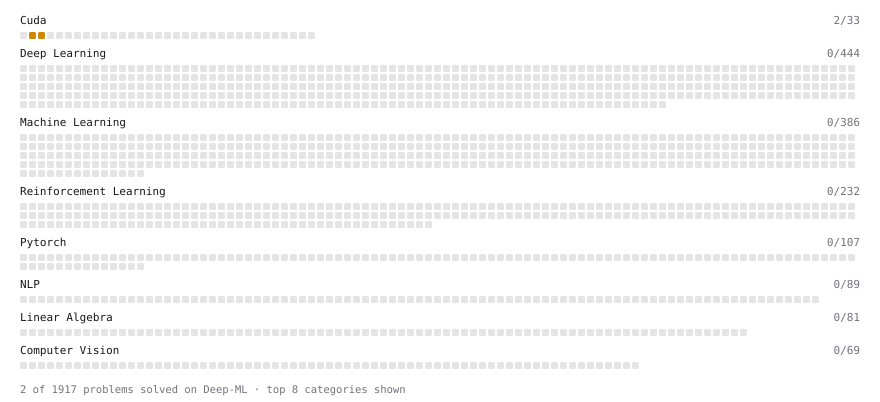

# Deep-ML

My machine learning practice from [Deep-ML](https://www.deep-ml.com). Every solution here was written by hand.

**2** solved · 2 problems · 0 labs · 0 math

[**Browse the interactive portfolio**](https://IDEA-V.github.io/deep-ml/) to replay this filling in over time.

## Problems

| | Difficulty | Solved | |
| --- | --- | --- | --- |
| [Fused Bias+ReLU CUDA Kernel](https://www.deep-ml.com/problems/1188) | medium | 2026-11-02 | [solution](problems/1188-fused-bias-relu-cuda-kernel) |
| [Parallel Reduction (Block Sum) CUDA Kernel](https://www.deep-ml.com/problems/1189) | medium | 2026-11-06 | [solution](problems/1189-parallel-reduction-block-sum-cuda-kernel) |

---

_This file is regenerated by Deep-ML on every push._
